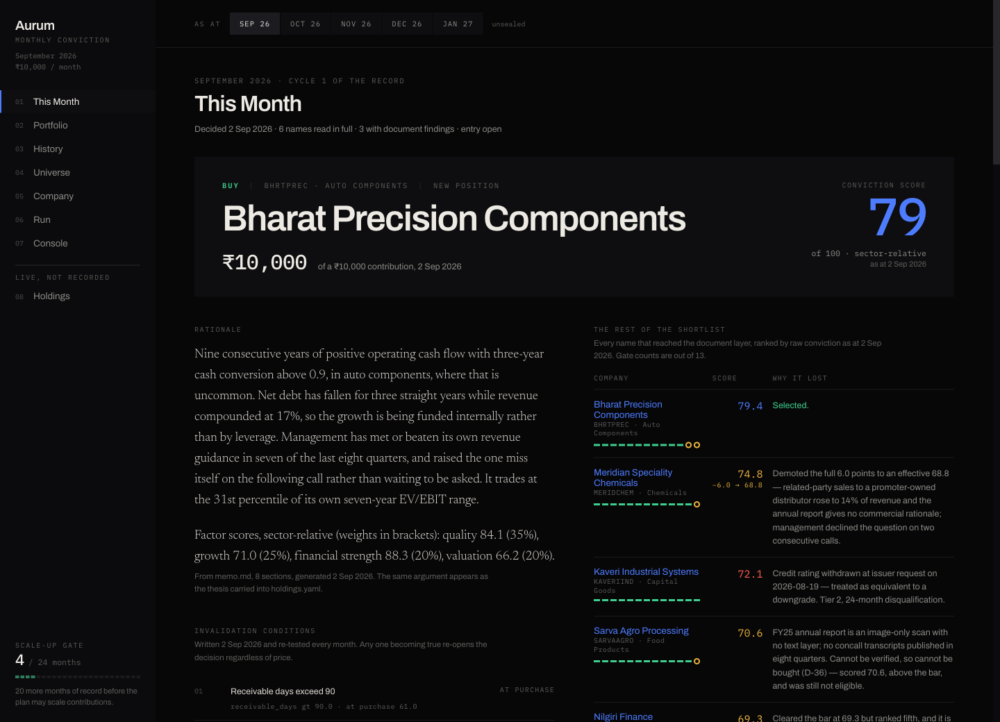
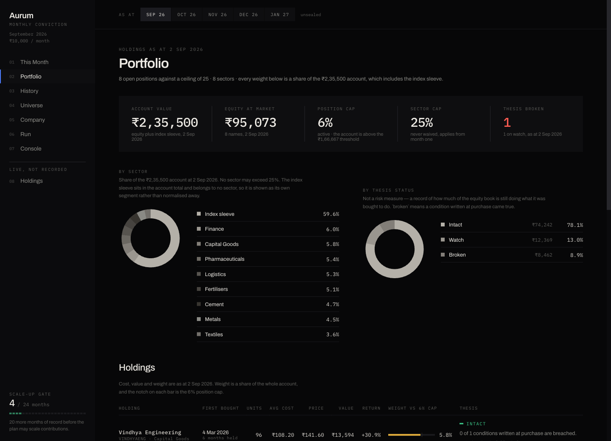
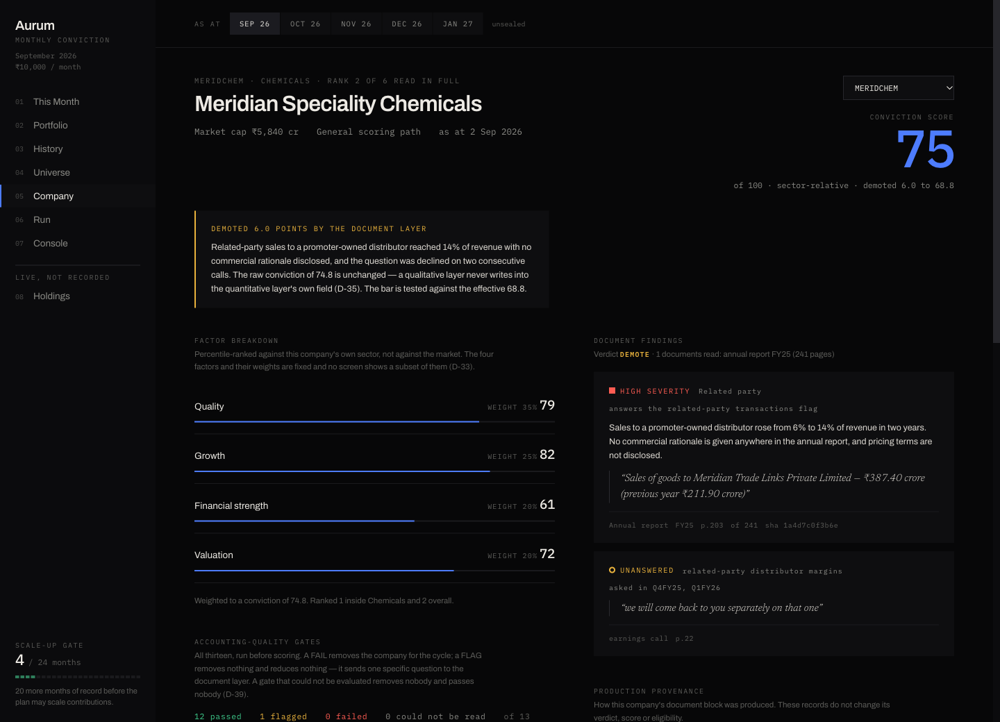
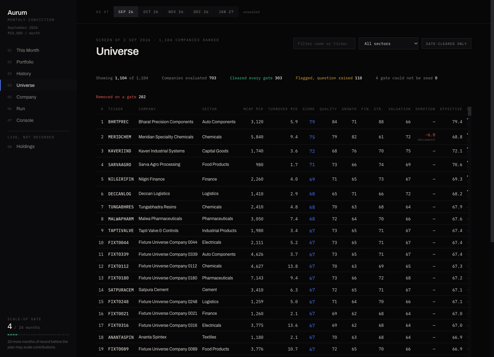
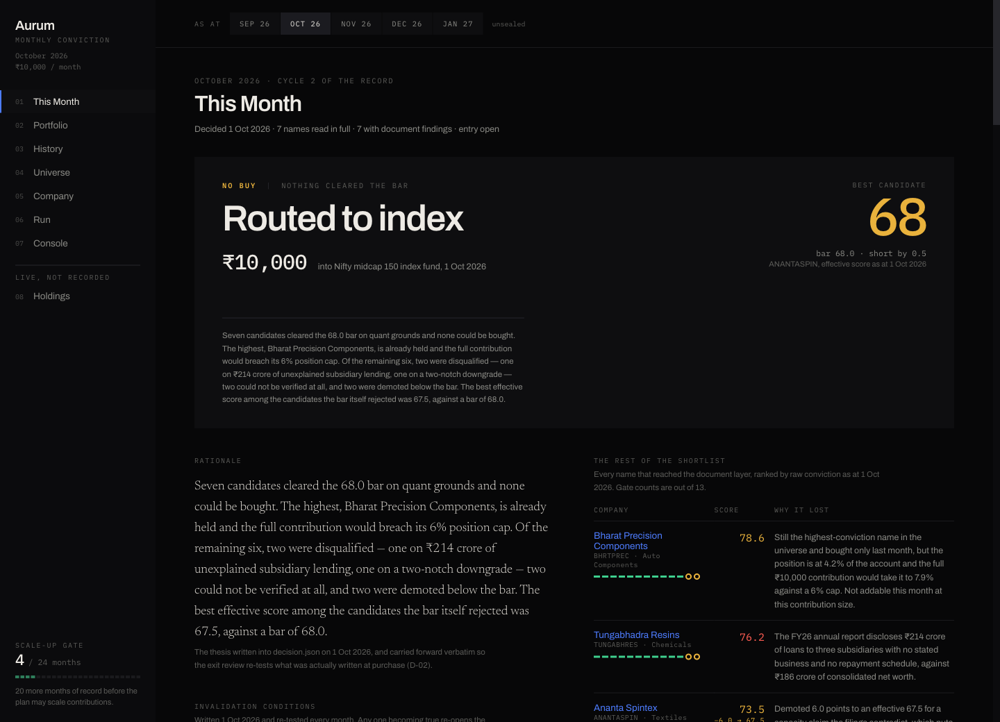
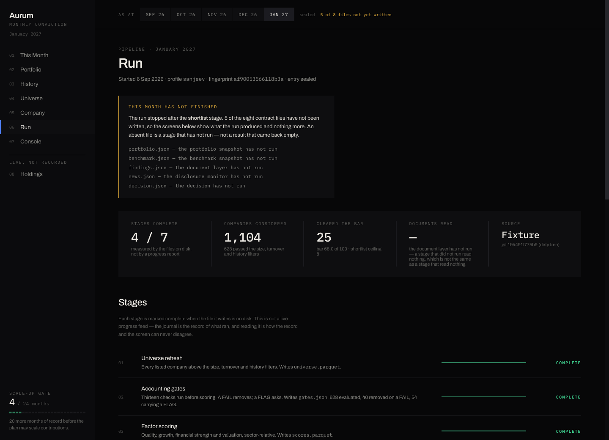
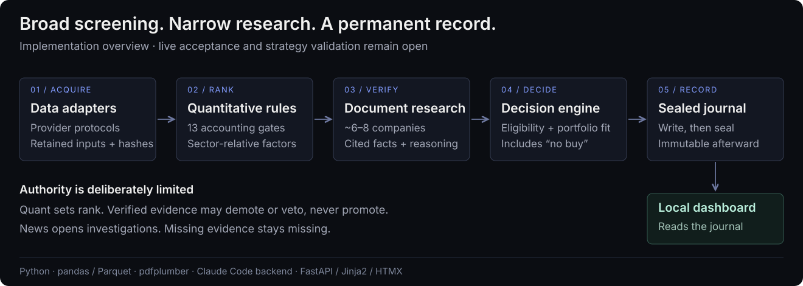

# Aurum

**An auditable research pipeline for Indian equities.**

Aurum turns a broad stock universe into a small, evidence-backed monthly decision: **buy, add, split between two names, or buy nothing**. It combines accounting checks and sector-relative scoring with document research, then records the inputs, findings and decision before the outcome is known.

I’m building it to make my own investment research more disciplined and inspectable. The interesting engineering problem is deciding what an AI model is allowed to influence, and retaining enough evidence to audit that decision later.

> **Status · 19 November 2026:** Active development, pre-1.0. The core pipeline, local dashboard and live runtime integration are implemented. Live acceptance, repeat document validation, strategy evaluation and go-live approval remain pending. **No demonstrated investment edge or approved real-money use is claimed.** [Detailed status and limitations →](docs/status.md)

The application source is private. This public repository contains screenshots and an engineering walkthrough; it does not contain a runnable app. A walkthrough is available on request.

*Captured from the running dashboard using fictional demo data. The decision, companies and figures above are illustrative.*

## What it does

- **Screen before ranking.** Apply universe filters and 13 accounting-quality checks, then score quality, growth, financial strength and valuation relative to sector peers.
- **Research a small shortlist.** Keep expensive document work to roughly 6–8 companies. Extract findings from reports, verify citations, and compare management promises with delivery where evidence is available.
- **Constrain AI authority.** Quantitative scoring sets rank. Verified qualitative evidence may demote or veto; it cannot promote. News opens investigations and carries no independent buy/sell authority.
- **Make the decision explicit.** Apply eligibility and portfolio constraints, retain a reachable “no buy” branch, and write a thesis with conditions that would invalidate it.
- **Preserve the record.** Hash retained inputs, record provenance, and seal monthly journal entries. The dashboard reads the journal without rewriting it.

These are implemented capabilities, not a claim that the complete live workflow has passed acceptance. Source coverage and document quality remain practical constraints.

## Screenshots

All captures use checked-in synthetic fixtures. The complete example months were hand-authored to exercise the interface; the partial-run example was generated by an earlier version of the pipeline. **These are UI examples, not live decisions, returns or validation results.** Older fixtures include legacy policy and source labels; current scope and limitations are described in [the status page](docs/status.md).

### Portfolio dashboard

Sector allocation, portfolio limits and thesis status in one view. All holdings and account values here are fictional; this is not a personal portfolio disclosure or a performance result. Cap values shown belong to the older fixture policy.

### Company research and cited evidence

Factor scores sit beside document findings, page references and verbatim quotes. This fictional example shows a document demotion alongside the unchanged raw quantitative score.

### Universe explorer

Inspect ranks, factor scores, gate outcomes and exclusion reasons. Search and sector filters help answer why a company did or did not make the shortlist.

### “No buy” is a valid outcome

The system can reject every candidate rather than manufacture a stock purchase. The current fallback is a specified Nifty Midcap 150 index fund.

### Incomplete runs stay visibly incomplete

A missing stage is displayed as “not run,” rather than appearing to have returned an empty or successful result. This older generated fixture stopped at the shortlist; it does not represent the current runtime’s maximum capability.

[Capture details →](docs/screenshots.md)

## Architecture

Python owns the research pipeline and decision logic. A local FastAPI application renders journal data with Jinja2 and HTMX. Data-provider interfaces isolate acquisition from the rules, allowing fixture-based tests without live providers or model calls.

[Engineering decisions and verification →](docs/engineering.md)

## Tech stack

Python 3.12+, pandas, PyArrow/Parquet, HTTPX, pdfplumber, FastAPI, Jinja2, HTMX, pytest, Ruff, mypy, uv and GitHub Actions. The configured live model backend invokes Claude Code for document extraction and reasoning.

## What is still pending

- Finish attended data acquisition and pass the full-universe live shakedown.
- Repeat the document probe on the completed pipeline, checking citation relevance and verdict stability; investigate and resolve its findings.
- Complete historical data-quality checks before the pre-registered strategy evaluation. An evaluation harness exists; a validated investing strategy does not.
- Lock the scoring recipe, entry threshold and remaining portfolio policies before viewing the resulting candidate names.
- Complete two consecutive monthly rehearsals, reproduce the memo from sealed inputs, and verify the operational workflow and backups.

There is no promised launch date. Evidence and acceptance gates determine readiness. [Status, known limitations and deferred work →](docs/status.md)

## My role and what I learned

I led product decisions and directed the AI coding workflow, using written architecture contracts, code review and required checks. AI agents generated the application code.

- **Put authority in code.** A model cannot promote a company because the verdict contract does not offer that action.
- **Distinguish missing evidence from a clean result.** An unreadable document, an unrun stage and a verified pass need different states throughout the pipeline and UI.
- **Test the research process itself.** An early real-company probe failed to distinguish clean controls from problematic ones. That exposed extraction and evidence-handling defects; the completed pipeline’s repeat probe remains open.
- **Keep replayable evidence.** Retaining input bytes, hashes and provenance makes a decision inspectable after providers or models change.
- **Separate software correctness from strategy validity.** Automated tests can verify behavior; they cannot establish that a strategy will outperform an index fund.

Aurum is an unproven personal research project. Nothing in this repository is investment advice.
